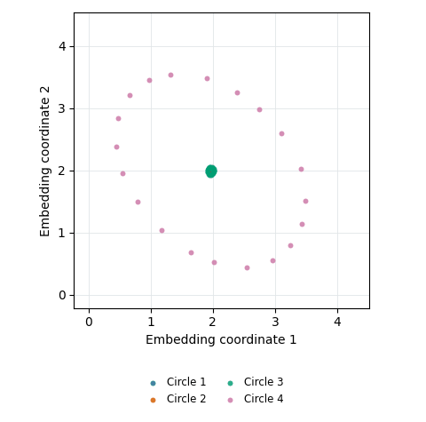
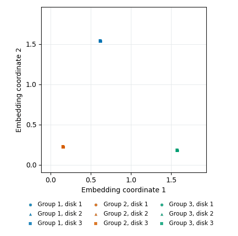
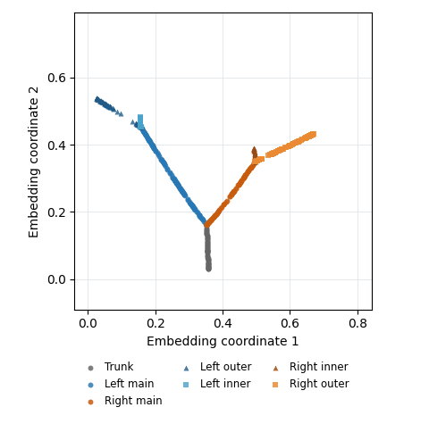

# Persistent Nonnegative Matrix Factorization via Multi-Scale Graph Regularization

Jichao Zhang and Limin Li

pNMF jointly learns a sequence of nonnegative embeddings, one at each distinct positive distance threshold where connected components merge. Coupling neighboring embeddings lets us track how sample relationships change across scales.

<p align="center">
  
  
  
</p>

From left to right, the animations show noncoplanar circles, hierarchical disks, and continuous branching. Each plays on fixed axes from the largest connectivity threshold (coarse) to the smallest (fine).

## Installation

Run the following commands to create the Python 3.11 environment.

```sh
git clone https://github.com/LiminLi-xjtu/pNMF.git
cd pNMF
conda env create -f environment.yml
conda activate pnmf
```

Run the examples from the repository root. For GPU fitting on a CUDA 12.x system, also run `python -m pip install cupy-cuda12x==13.6.0`.

## Recreate a synthetic animation

```sh
python -m examples.synthetic --dataset circles --device cpu
```

Choose `circles`, `disks`, or `branching`. The example fits pNMF to the supplied data and saves the animation as a GIF in `outputs/synthetic/`. The accompanying NPZ file contains the full embedding sequence and its thresholds. [Fit settings](examples/synthetic_settings.json)

## Single-cell clustering

### Score the saved embeddings

Each dataset includes a `reference_embeddings.npz` file with one embedding matrix per method and one column per cell. For pNMF, the saved matrix is $Z_1$, the embedding used for clustering at the first positive scale of the joint fit. [GSE75748time embeddings](data/single_cell/GSE75748time/reference_embeddings.npz) · [Dendritic_batch1 embeddings](data/single_cell/Dendritic_batch1/reference_embeddings.npz)

`score` runs k-means on each saved matrix. It takes the number of clusters from `labels.csv` and compares the resulting clusters with those labels to compute ARI, NMI, purity, and accuracy. The command below writes the scores for both datasets to a new CSV.

```sh
python -m examples.single_cell score --output outputs/scores.csv
```

| Dataset | Method | ARI | NMI | Purity | Accuracy |
|---|---|---:|---:|---:|---:|
| GSE75748time | NMF | 0.6107 | 0.7347 | 0.7454 | 0.6926 |
| | GNMF | 0.6010 | 0.7301 | 0.7203 | 0.6794 |
| | TNMF | 0.6483 | 0.7640 | 0.7150 | 0.7098 |
| | k-TNMF | 0.5924 | 0.7107 | 0.7507 | 0.7361 |
| | pNMF | 0.7472 | 0.8572 | 0.8813 | 0.8813 |
| Dendritic_batch1 | NMF | 0.5668 | 0.6726 | 0.7005 | 0.7005 |
| | GNMF | 0.5907 | 0.6857 | 0.7057 | 0.7031 |
| | TNMF | 0.2948 | 0.4851 | 0.4922 | 0.4896 |
| | k-TNMF | 0.6184 | 0.7155 | 0.7135 | 0.7135 |
| | pNMF | 0.7598 | 0.7927 | 0.9089 | 0.9089 |

[Full-precision reference scores](data/single_cell/reference_scores.csv)

### Refit from the expression matrix

`fit` reads `expression.csv.gz`, applies the preprocessing and model settings in the dataset's `config.json`, and scores the newly fitted embeddings using the same procedure. It keeps the embeddings in memory and writes the four scores per method to the specified CSV.

```sh
python -m examples.single_cell fit --dataset Dendritic_batch1 --device cuda:0 --output outputs/batch1_refit.csv
```

This example fits pNMF on the GPU and all four baselines on the CPU. Use `--device cpu` for a CPU-only run, `--dataset GSE75748time` for the other dataset, or `--methods NMF GNMF` to fit selected methods.

## License and sources

The original pNMF code is available under the MIT license. The single-cell datasets come from Chu et al. and Villani et al. The persistent-homology implementation credits Hozumi and Wei. [License](LICENSE) · [Data sources and preprocessing](data/single_cell/README.md) · [TopologicalNMF-scRNAseq](https://github.com/hozumiyu/TopologicalNMF-scRNAseq)
